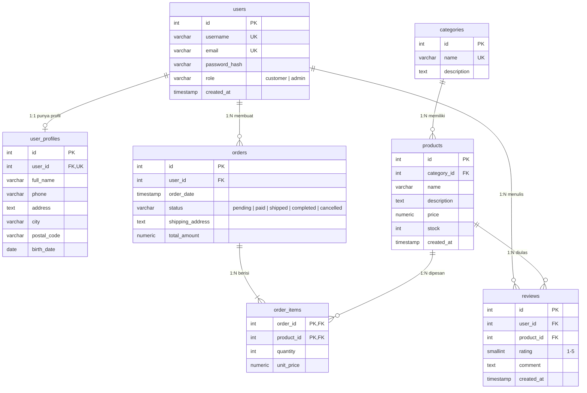

# ERD - Sistem Toko Online

Diagram di bawah ditulis dengan Mermaid (otomatis tampil di GitHub dan VS Code lewat ekstensi *Markdown Preview Mermaid Support*). Skema SQL lengkap: [`../schema.sql`](../schema.sql).

| Relasi | Tipe | Aturan hapus |
|---|---|---|
| users - user_profiles | 1:1 (`user_id` UNIQUE) | CASCADE |
| users - orders | 1:N | RESTRICT (user dengan order tidak bisa dihapus) |
| categories - products | 1:N | RESTRICT |
| orders - products (via order_items) | N:N (PK gabungan `order_id, product_id`) | order CASCADE, product RESTRICT |
| users/products - reviews | 1:N, unik per (user, produk) | CASCADE |
