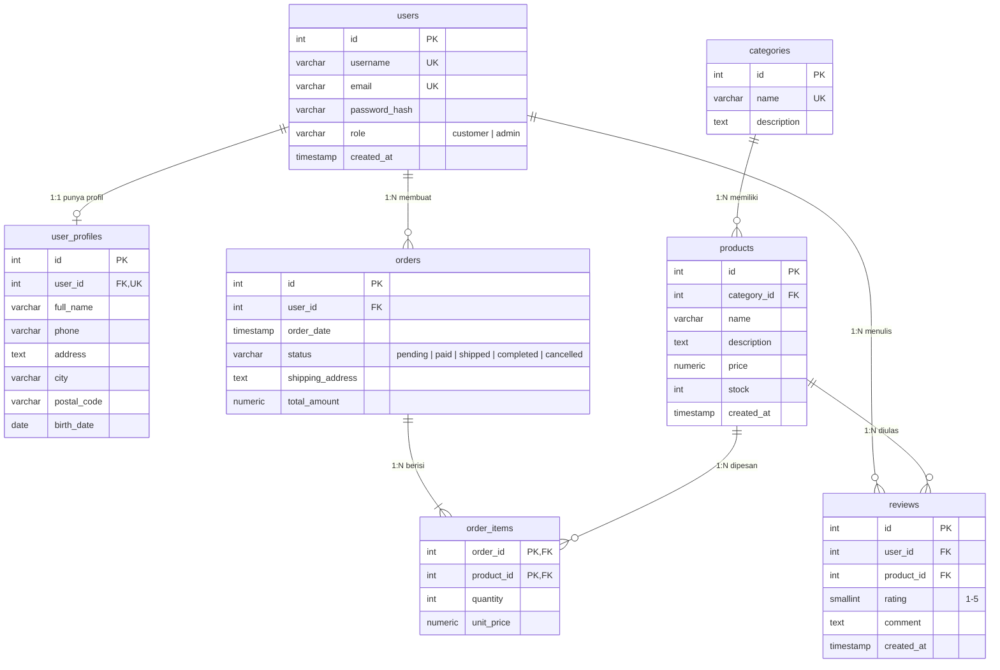

# Toko Online REST API

REST API sederhana untuk sistem toko online (e-commerce): manajemen user, profil, kategori, produk, order, dan review. Tugas Akhir Learning Labs: Backend Development.

- **Nama**: Akhmad Nur Faozan (21114022610003)
- **Repository**: lihat [LINK-PENGUMPULAN.md](LINK-PENGUMPULAN.md)
- **Deployment (Vercel)**: lihat [LINK-PENGUMPULAN.md](LINK-PENGUMPULAN.md)

## Teknologi
Node.js 18+, Express.js 4, PostgreSQL (driver `pg`), bcryptjs (hash password), dotenv. Deploy ke Vercel (serverless function `api/index.js`) dengan database PostgreSQL online (Supabase/Neon).

## ERD / Skema Database
7 tabel berelasi foreign key (skema lengkap: [`schema.sql`](../schema.sql), detail relasi: [ERD.md](ERD.md)).



## Fitur
- CRUD lengkap: **products**, categories, reviews, users, profil user (1:1), order (create/read/ubah status/hapus).
- Validasi input (tipe, wajib diisi, format email/tanggal, rating 1-5, harga/stok >= 0) dan status HTTP tepat: 200, 201, 400, 401, 404, 409, 500. Semua response berformat JSON; error: `{ "error": "pesan" }`.
- Password di-hash dengan bcrypt (cost 10), `password_hash` tidak pernah dikirim ke client; role selalu `customer` saat register.
- Pembuatan order memakai transaksi database: total dihitung server dari harga produk, stok berkurang otomatis, dan dikembalikan saat order dibatalkan.
- Query memakai parameter (`$1, $2`) sehingga aman dari SQL injection. Catatan: API ini belum memakai token/JWT (di luar syarat tugas), jadi endpoint belum dibatasi per role.

## Menjalankan Secara Lokal
```bash
git clone <URL-REPOSITORY> && cd <nama-folder>
npm install
cp .env.example .env          # isi DATABASE_URL milik kamu (Windows: copy .env.example .env)
psql "$DATABASE_URL" -f schema.sql   # membuat 7 tabel + data contoh
npm start                     # http://localhost:3000
npm run test:api              # pengujian otomatis semua endpoint
npm run docs                  # perbarui dokumen/koleksi setelah pengujian
```
Catatan: `schema.sql` memakai `DROP TABLE` sehingga mengosongkan data lama. User contoh di `schema.sql` memakai hash palsu, jadi login hanya bisa dengan user hasil `POST /auth/register`.

## Deployment ke Vercel
1. Push repository ke GitHub (pastikan `.env` tidak ikut; sudah ada di `.gitignore`).
2. Buat database PostgreSQL online (Supabase: Project Settings > Database > Connection string, pilih *Transaction pooler*; atau Neon). Jalankan isi `schema.sql` di SQL Editor-nya.
3. Di vercel.com: *Add New > Project* > import repository (Framework Preset: Other).
4. Settings > Environment Variables: `DATABASE_URL` = connection string, `DB_SSL` = `true`. Jangan menaruh nilai ini di kode.
5. Deploy, lalu uji: `BASE_URL=https://nama-project.vercel.app npm run test:api`.

## Dokumentasi Endpoint
Base URL: `{{BASE_URL}}` = URL Vercel (lokal: `http://localhost:3000`). Semua request/response berformat JSON. `:id` diganti ID data. Dihasilkan dari `scripts/spec.js`; bentuk response di bawah masih generik karena pengujian belum dijalankan, jalankan `npm run test:api` lalu `npm run docs` untuk mengisinya dengan response asli.

### GET /
- Method : GET
- URL : `{{BASE_URL}}/`
- Deskripsi : Informasi API
- Headers : -
- Request Body :
  -
- Response Sukses (200):
```json
{ "name": "REST API Sistem Toko Online", "endpoints": [ ... ] }
```
- Response Error: `{ "error": "<pesan kesalahan>" }`

### POST /auth/register
- Method : POST
- URL : `{{BASE_URL}}/auth/register`
- Deskripsi : Mendaftarkan user baru (role selalu customer, password di-hash bcrypt)
- Headers : `Content-Type: application/json`
- Request Body :
```json
{
  "username": "tester_uji1",
  "email": "tester_uji1@example.com",
  "password": "Passw0rd123"
}
```
- Response Sukses (201):
```json
{ "message": "... berhasil ...", "data": { ... } }
```
- Response Error: 
  - **409** (Register duplikat): `{ "error": "<pesan kesalahan>" }`
  - **400** (Register input tidak valid): `{ "error": "<pesan kesalahan>" }`

### POST /auth/login
- Method : POST
- URL : `{{BASE_URL}}/auth/login`
- Deskripsi : Login dengan email dan password
- Headers : `Content-Type: application/json`
- Request Body :
```json
{
  "email": "tester_uji1@example.com",
  "password": "Passw0rd123"
}
```
- Response Sukses (200):
```json
{ "message": "... berhasil ...", "data": { ... } }
```
- Response Error: 
  - **401** (Login password salah): `{ "error": "<pesan kesalahan>" }`

### GET /users
- Method : GET
- URL : `{{BASE_URL}}/users`
- Deskripsi : Mengambil semua user (tanpa password)
- Headers : -
- Request Body :
  -
- Response Sukses (200):
```json
{ "data": [ ... ] }
```
- Response Error: `{ "error": "<pesan kesalahan>" }`

### GET /users/:id
- Method : GET
- URL : `{{BASE_URL}}/users/:id`
- Deskripsi : Mengambil satu user berdasarkan ID
- Headers : -
- Request Body :
  -
- Response Sukses (200):
```json
{ "data": { ... } }
```
- Response Error: 
  - **404** (User tidak ditemukan): `{ "error": "<pesan kesalahan>" }`
  - **400** (ID bukan angka): `{ "error": "<pesan kesalahan>" }`

### PUT /users/:id
- Method : PUT
- URL : `{{BASE_URL}}/users/:id`
- Deskripsi : Mengganti username dan email (keduanya wajib)
- Headers : `Content-Type: application/json`
- Request Body :
```json
{
  "username": "tester_uji1",
  "email": "tester_uji1@example.com"
}
```
- Response Sukses (200):
```json
{ "message": "... berhasil ...", "data": { ... } }
```
- Response Error: 
  - **400** (PUT tanpa email): `{ "error": "<pesan kesalahan>" }`

### PATCH /users/:id
- Method : PATCH
- URL : `{{BASE_URL}}/users/:id`
- Deskripsi : Mengubah sebagian data user (username, email, password)
- Headers : `Content-Type: application/json`
- Request Body :
```json
{
  "password": "NewPassw0rd9"
}
```
- Response Sukses (200):
```json
{ "message": "... berhasil ...", "data": { ... } }
```
- Response Error: 
  - **400** (PATCH kosong): `{ "error": "<pesan kesalahan>" }`

### PUT /users/:id/profile
- Method : PUT
- URL : `{{BASE_URL}}/users/:id/profile`
- Deskripsi : Membuat profil user (201) atau mengganti profil yang sudah ada (200) - relasi 1:1
- Headers : `Content-Type: application/json`
- Request Body :
```json
{
  "full_name": "Tester Uji",
  "city": "Kebumen",
  "birth_date": "2000-01-31"
}
```
- Response Sukses (201):
```json
{ "message": "... berhasil ...", "data": { ... } }
```
- Response Error: 
  - **400** (Profil tanpa full_name): `{ "error": "<pesan kesalahan>" }`
  - **404** (Profil user tidak ada): `{ "error": "<pesan kesalahan>" }`

### GET /users/:id/profile
- Method : GET
- URL : `{{BASE_URL}}/users/:id/profile`
- Deskripsi : Mengambil profil user
- Headers : -
- Request Body :
  -
- Response Sukses (200):
```json
{ "data": { ... } }
```
- Response Error: 
  - **404** (Profil tidak ditemukan): `{ "error": "<pesan kesalahan>" }`

### PATCH /users/:id/profile
- Method : PATCH
- URL : `{{BASE_URL}}/users/:id/profile`
- Deskripsi : Mengubah sebagian data profil
- Headers : `Content-Type: application/json`
- Request Body :
```json
{
  "phone": "081100001111"
}
```
- Response Sukses (200):
```json
{ "message": "... berhasil ...", "data": { ... } }
```
- Response Error: `{ "error": "<pesan kesalahan>" }`

### POST /categories
- Method : POST
- URL : `{{BASE_URL}}/categories`
- Deskripsi : Menambah kategori
- Headers : `Content-Type: application/json`
- Request Body :
```json
{
  "name": "Kategori Uji uji1",
  "description": "Dibuat oleh pengujian otomatis"
}
```
- Response Sukses (201):
```json
{ "message": "... berhasil ...", "data": { ... } }
```
- Response Error: 
  - **409** (Kategori duplikat): `{ "error": "<pesan kesalahan>" }`
  - **400** (Kategori tanpa nama): `{ "error": "<pesan kesalahan>" }`

### GET /categories
- Method : GET
- URL : `{{BASE_URL}}/categories`
- Deskripsi : Mengambil semua kategori
- Headers : -
- Request Body :
  -
- Response Sukses (200):
```json
{ "data": [ ... ] }
```
- Response Error: `{ "error": "<pesan kesalahan>" }`

### GET /categories/:id
- Method : GET
- URL : `{{BASE_URL}}/categories/:id`
- Deskripsi : Mengambil satu kategori
- Headers : -
- Request Body :
  -
- Response Sukses (200):
```json
{ "data": { ... } }
```
- Response Error: 
  - **404** (Kategori tidak ditemukan): `{ "error": "<pesan kesalahan>" }`

### PUT /categories/:id
- Method : PUT
- URL : `{{BASE_URL}}/categories/:id`
- Deskripsi : Mengganti seluruh data kategori
- Headers : `Content-Type: application/json`
- Request Body :
```json
{
  "name": "Kategori Uji uji1",
  "description": "Diganti"
}
```
- Response Sukses (200):
```json
{ "message": "... berhasil ...", "data": { ... } }
```
- Response Error: `{ "error": "<pesan kesalahan>" }`

### PATCH /categories/:id
- Method : PATCH
- URL : `{{BASE_URL}}/categories/:id`
- Deskripsi : Mengubah sebagian data kategori
- Headers : `Content-Type: application/json`
- Request Body :
```json
{
  "description": "Deskripsi baru"
}
```
- Response Sukses (200):
```json
{ "message": "... berhasil ...", "data": { ... } }
```
- Response Error: `{ "error": "<pesan kesalahan>" }`

### POST /products
- Method : POST
- URL : `{{BASE_URL}}/products`
- Deskripsi : Menambah produk (CRUD lengkap)
- Headers : `Content-Type: application/json`
- Request Body :
```json
{
  "category_id": 1,
  "name": "Produk Uji uji1",
  "description": "Barang uji",
  "price": 150000,
  "stock": 10
}
```
- Response Sukses (201):
```json
{ "message": "... berhasil ...", "data": { ... } }
```
- Response Error: 
  - **400** (Harga negatif): `{ "error": "<pesan kesalahan>" }`
  - **400** (Kategori tidak ada): `{ "error": "<pesan kesalahan>" }`

### GET /products
- Method : GET
- URL : `{{BASE_URL}}/products`
- Deskripsi : Mengambil semua produk. Query opsional: q (cari nama/deskripsi), category_id
- Headers : -
- Request Body :
  -
- Response Sukses (200):
```json
{ "data": [ ... ] }
```
- Response Error: `{ "error": "<pesan kesalahan>" }`

### GET /products/:id
- Method : GET
- URL : `{{BASE_URL}}/products/:id`
- Deskripsi : Detail produk beserta avg_rating dan review_count
- Headers : -
- Request Body :
  -
- Response Sukses (200):
```json
{ "data": { ... } }
```
- Response Error: 
  - **404** (Produk tidak ditemukan): `{ "error": "<pesan kesalahan>" }`

### PUT /products/:id
- Method : PUT
- URL : `{{BASE_URL}}/products/:id`
- Deskripsi : Mengganti seluruh data produk
- Headers : `Content-Type: application/json`
- Request Body :
```json
{
  "category_id": 1,
  "name": "Produk Uji uji1",
  "description": "Barang uji",
  "price": 160000,
  "stock": 10
}
```
- Response Sukses (200):
```json
{ "message": "... berhasil ...", "data": { ... } }
```
- Response Error: `{ "error": "<pesan kesalahan>" }`

### PATCH /products/:id
- Method : PATCH
- URL : `{{BASE_URL}}/products/:id`
- Deskripsi : Mengubah sebagian data produk
- Headers : `Content-Type: application/json`
- Request Body :
```json
{
  "stock": 20
}
```
- Response Sukses (200):
```json
{ "message": "... berhasil ...", "data": { ... } }
```
- Response Error: `{ "error": "<pesan kesalahan>" }`

### POST /orders
- Method : POST
- URL : `{{BASE_URL}}/orders`
- Deskripsi : Membuat order: total dihitung server, stok produk otomatis berkurang (transaksi database)
- Headers : `Content-Type: application/json`
- Request Body :
```json
{
  "user_id": 1,
  "shipping_address": "Jl. Uji No. 1, Kebumen",
  "items": [
    {
      "product_id": 1,
      "quantity": 2
    }
  ]
}
```
- Response Sukses (201):
```json
{ "message": "... berhasil ...", "data": { ... } }
```
- Response Error: 
  - **400** (Stok tidak cukup): `{ "error": "<pesan kesalahan>" }`
  - **400** (Items kosong): `{ "error": "<pesan kesalahan>" }`
  - **400** (User tidak ada): `{ "error": "<pesan kesalahan>" }`

### GET /orders
- Method : GET
- URL : `{{BASE_URL}}/orders`
- Deskripsi : Mengambil semua order. Query opsional: user_id, status
- Headers : -
- Request Body :
  -
- Response Sukses (200):
```json
{ "data": [ ... ] }
```
- Response Error: `{ "error": "<pesan kesalahan>" }`

### GET /orders/:id
- Method : GET
- URL : `{{BASE_URL}}/orders/:id`
- Deskripsi : Detail order beserta item
- Headers : -
- Request Body :
  -
- Response Sukses (200):
```json
{ "data": { ... } }
```
- Response Error: 
  - **404** (Order tidak ditemukan): `{ "error": "<pesan kesalahan>" }`

### PATCH /orders/:id
- Method : PATCH
- URL : `{{BASE_URL}}/orders/:id`
- Deskripsi : Mengubah alamat pengiriman (hanya saat pending)
- Headers : `Content-Type: application/json`
- Request Body :
```json
{
  "shipping_address": "Jl. Baru No. 2, Kebumen"
}
```
- Response Sukses (200):
```json
{ "message": "... berhasil ...", "data": { ... } }
```
- Response Error: 
  - **400** (Ubah alamat setelah paid): `{ "error": "<pesan kesalahan>" }`

### PATCH /orders/:id/status
- Method : PATCH
- URL : `{{BASE_URL}}/orders/:id/status`
- Deskripsi : Mengubah status: pending->paid|cancelled, paid->shipped|cancelled, shipped->completed. Cancelled mengembalikan stok
- Headers : `Content-Type: application/json`
- Request Body :
```json
{
  "status": "paid"
}
```
- Response Sukses (200):
```json
{ "message": "... berhasil ...", "data": { ... } }
```
- Response Error: 
  - **400** (Transisi status tidak valid): `{ "error": "<pesan kesalahan>" }`
  - **400** (Nilai status tidak valid): `{ "error": "<pesan kesalahan>" }`

### POST /reviews
- Method : POST
- URL : `{{BASE_URL}}/reviews`
- Deskripsi : Menambah review produk (rating 1-5, satu user satu review per produk)
- Headers : `Content-Type: application/json`
- Request Body :
```json
{
  "user_id": 1,
  "product_id": 1,
  "rating": 5,
  "comment": "Bagus"
}
```
- Response Sukses (201):
```json
{ "message": "... berhasil ...", "data": { ... } }
```
- Response Error: 
  - **409** (Review duplikat): `{ "error": "<pesan kesalahan>" }`
  - **400** (Rating di luar 1-5): `{ "error": "<pesan kesalahan>" }`

### GET /reviews
- Method : GET
- URL : `{{BASE_URL}}/reviews`
- Deskripsi : Mengambil review. Query opsional: product_id, user_id
- Headers : -
- Request Body :
  -
- Response Sukses (200):
```json
{ "data": [ ... ] }
```
- Response Error: `{ "error": "<pesan kesalahan>" }`

### GET /reviews/:id
- Method : GET
- URL : `{{BASE_URL}}/reviews/:id`
- Deskripsi : Mengambil satu review
- Headers : -
- Request Body :
  -
- Response Sukses (200):
```json
{ "data": { ... } }
```
- Response Error: `{ "error": "<pesan kesalahan>" }`

### PUT /reviews/:id
- Method : PUT
- URL : `{{BASE_URL}}/reviews/:id`
- Deskripsi : Mengganti seluruh data review
- Headers : `Content-Type: application/json`
- Request Body :
```json
{
  "user_id": 1,
  "product_id": 1,
  "rating": 4,
  "comment": "Oke"
}
```
- Response Sukses (200):
```json
{ "message": "... berhasil ...", "data": { ... } }
```
- Response Error: `{ "error": "<pesan kesalahan>" }`

### PATCH /reviews/:id
- Method : PATCH
- URL : `{{BASE_URL}}/reviews/:id`
- Deskripsi : Mengubah sebagian data review
- Headers : `Content-Type: application/json`
- Request Body :
```json
{
  "rating": 3
}
```
- Response Sukses (200):
```json
{ "message": "... berhasil ...", "data": { ... } }
```
- Response Error: `{ "error": "<pesan kesalahan>" }`

### DELETE /reviews/:id
- Method : DELETE
- URL : `{{BASE_URL}}/reviews/:id`
- Deskripsi : Menghapus review
- Headers : -
- Request Body :
  -
- Response Sukses (200):
```json
{ "message": "... berhasil dihapus" }
```
- Response Error: 
  - **404** (Hapus review lagi): `{ "error": "<pesan kesalahan>" }`

### DELETE /categories/:id
- Method : DELETE
- URL : `{{BASE_URL}}/categories/:id`
- Deskripsi : Menghapus kategori (ditolak 409 jika masih dipakai produk)
- Headers : -
- Request Body :
  -
- Response Sukses (200):
```json
{ "message": "... berhasil dihapus" }
```
- Response Error: 
  - **409** (Kategori masih dipakai produk): `{ "error": "<pesan kesalahan>" }`

### DELETE /users/:id
- Method : DELETE
- URL : `{{BASE_URL}}/users/:id`
- Deskripsi : Menghapus user (ditolak 409 jika masih punya order)
- Headers : -
- Request Body :
  -
- Response Sukses (200):
```json
{ "message": "... berhasil dihapus" }
```
- Response Error: 
  - **409** (User masih punya order): `{ "error": "<pesan kesalahan>" }`

### DELETE /orders/:id
- Method : DELETE
- URL : `{{BASE_URL}}/orders/:id`
- Deskripsi : Menghapus order (hanya yang berstatus cancelled)
- Headers : -
- Request Body :
  -
- Response Sukses (200):
```json
{ "message": "... berhasil dihapus" }
```
- Response Error: 
  - **400** (Hapus order belum cancelled): `{ "error": "<pesan kesalahan>" }`

### DELETE /products/:id
- Method : DELETE
- URL : `{{BASE_URL}}/products/:id`
- Deskripsi : Menghapus produk
- Headers : -
- Request Body :
  -
- Response Sukses (200):
```json
{ "message": "... berhasil dihapus" }
```
- Response Error: 
  - **404** (Hapus produk lagi): `{ "error": "<pesan kesalahan>" }`

### DELETE /users/:id/profile
- Method : DELETE
- URL : `{{BASE_URL}}/users/:id/profile`
- Deskripsi : Menghapus profil user
- Headers : -
- Request Body :
  -
- Response Sukses (200):
```json
{ "message": "... berhasil dihapus" }
```
- Response Error: 
  - **404** (Hapus profil lagi): `{ "error": "<pesan kesalahan>" }`

## Pengujian
Koleksi Thunder Client: [thunder-collection.json](thunder-collection.json) dan [thunder-environment.json](thunder-environment.json) (ubah `baseUrl` ke URL Vercel). Hasil pengujian: [BUKTI-PENGUJIAN.md](BUKTI-PENGUJIAN.md).
